<picture>
  <source media="(prefers-color-scheme: dark)" srcset="hero-dark.svg">
  
</picture>

I build mobile apps and web interfaces that feel quiet, fast, and easy to use.
Two years in, mostly with **React**, **React Native**, and **TypeScript** — and enough PHP and SQL to ship the backend when it's needed.

### Now

- Building healthcare software at Indotelemed — web dashboards and a mobile app
- Getting better at the boring parts: performance, accessibility, clean handoffs

### Stack

 

Also: React Native, React Router, CodeIgniter, SQL Server

### Elsewhere

[garinravindra.com](https://garinravindra.com) ·
[LinkedIn](https://www.linkedin.com/in/garin-ravindra-8933a329a/) ·
[Instagram](https://www.instagram.com/niko_rgarin/) ·
[garinravindra911@gmail.com](mailto:garinravindra911@gmail.com)
